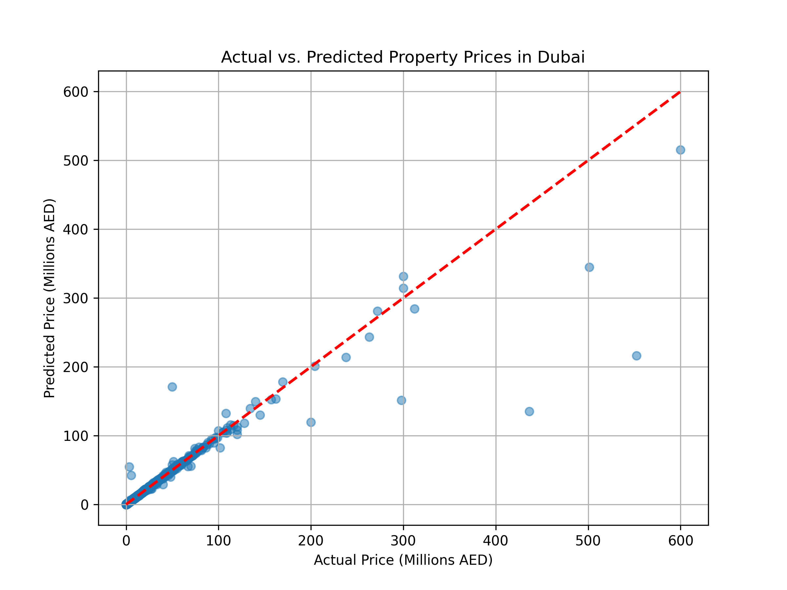

# Dubai Real Estate Price Prediction 🇦🇪

## 📌 Overview
An end-to-end machine learning project utilizing historical Dubai Land Department (DLD) real estate transaction data to train a Random Forest Regressor and predict property market valuations.

## 🛠 Tech Stack
* **Language:** Python
* **Libraries:** Pandas, NumPy, Scikit-Learn, Matplotlib
* **Model:** Random Forest Regressor

## 📊 Model Performance
* **Mean Absolute Error (MAE):** AED 212,208.48
* **Accuracy ($R^2$ Score):** 89.47%

## 📈 Actual vs. Predicted Prices

